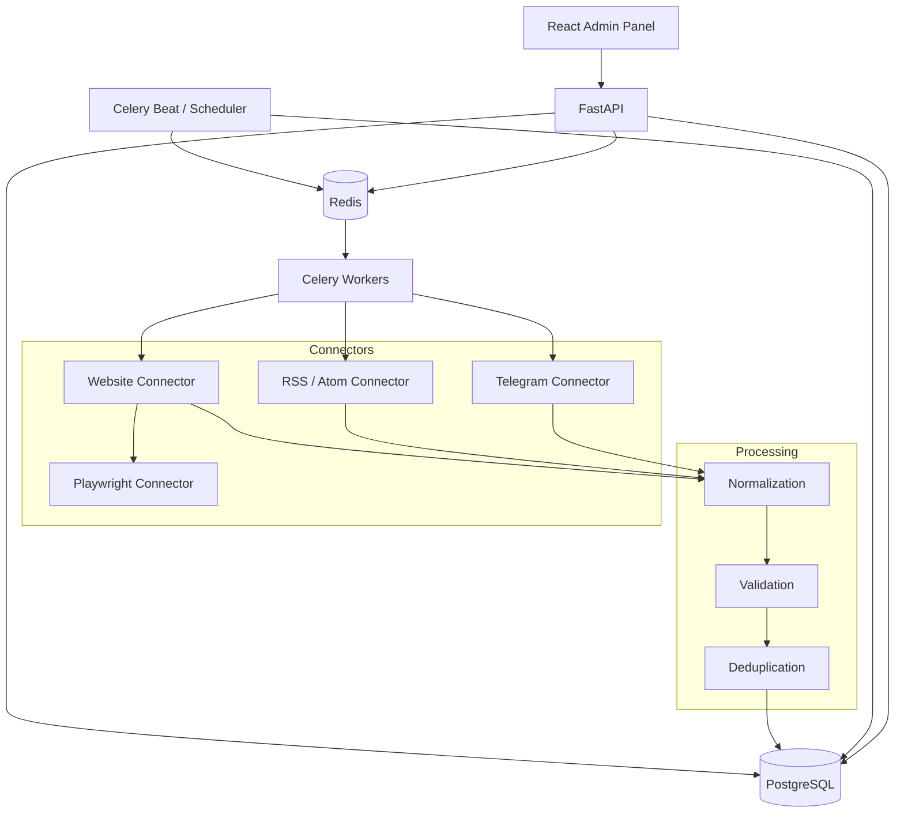

# سند معماری فنی پلتفرم جمع‌آوری و پایش منابع

**وضعیت:** پیشنویس معماری پیش از پیاده‌سازی  
**نسخه:** 1.0  
**نوع محصول:** پلتفرم متمرکز جمع‌آوری، نرمال‌سازی، پایش و جست‌وجوی محتوای منابع  
**مبنای طراحی:** MVP با حدود ۵۰ منبع اولیه و امکان توسعه تدریجی

---

## ۱. هدف پروژه

ساخت یک پلتفرم متمرکز برای دریافت و پایش محتوای منابع مختلف شامل:

- کانال‌های تلگرام
- فیدهای RSS و Atom
- وب‌سایت‌ها و صفحات خبری
- وب‌سایت‌های دارای ساختار اختصاصی یا محتوای JavaScript

سیستم باید بتواند محتوا را به‌صورت زمان‌بندی‌شده دریافت کند، داده‌ها را به ساختار یکسان تبدیل کند، موارد تکراری را تشخیص دهد و امکان جست‌وجو، فیلتر، مرتب‌سازی و مدیریت منابع را از طریق پنل مدیریتی فراهم کند.

هدف MVP ایجاد یک زیرساخت قابل‌اعتماد برای جمع‌آوری و جست‌وجوی محتواست؛ نه ساخت یک سامانه هوشمند تحلیل اخبار یا استخراج اطلاعات با هوش مصنوعی.

### اهداف اصلی

1. مدیریت متمرکز منابع و تنظیمات دریافت اطلاعات.
2. جمع‌آوری خودکار و زمان‌بندی‌شده محتوا.
3. پشتیبانی از چند نوع منبع با Connectorهای مستقل.
4. تشخیص محتوای تکراری و جلوگیری از ثبت چندباره.
5. ذخیره اطلاعات خام و نسخه نرمال‌شده.
6. امکان پیگیری وضعیت اجرای هر منبع و خطاهای آن.
7. جست‌وجوی متنی و فیلتر پیشرفته محتوا.
8. ارائه پنل مدیریتی برای مدیریت منابع و بررسی وضعیت سیستم.

---

## ۲. محدوده MVP

### ۲.۱ قابلیت‌های داخل محدوده

| بخش | قابلیت |
|---|---|
| مدیریت منابع | ایجاد، ویرایش، فعال‌سازی و غیرفعال‌سازی منابع |
| زمان‌بندی | تنظیم فاصله دریافت اطلاعات برای هر منبع |
| جمع‌آوری | دریافت اطلاعات از Telegram، RSS/Atom و وب‌سایت |
| استخراج | استخراج عنوان، متن، تاریخ، لینک و اطلاعات اصلی محتوا |
| نرمال‌سازی | تبدیل خروجی Connectorها به ساختار مشترک |
| تشخیص تکرار | جلوگیری از ثبت مجدد یک محتوا |
| تاریخچه | ذخیره سوابق اجرای منابع و خطاها |
| تغییرات محتوا | نگهداری نسخه‌های تغییرکرده محتوا در صورت نیاز |
| جست‌وجو | جست‌وجوی متنی، فیلتر و مرتب‌سازی |
| پنل مدیریت | داشبورد، مدیریت منابع، تاریخچه اجرا و بررسی محتوا |
| عملیات | ثبت خطا، تلاش مجدد و مشاهده وضعیت سلامت منابع |

### ۲.۲ موارد خارج از محدوده MVP

موارد زیر عمداً در فاز اول پیاده‌سازی نمی‌شوند:

- دسته‌بندی هوشمند با LLM
- استخراج موجودیت‌ها و ارتباط بین اشخاص، شرکت‌ها و سازمان‌ها
- Entity Resolution و تطبیق هوشمند اشخاص یا شرکت‌ها
- جست‌وجوی معنایی و Vector Search
- Embedding و پایگاه داده برداری
- خلاصه‌سازی خودکار محتوا
- تحلیل احساسات و تشخیص موضوع با هوش مصنوعی
- سیستم امتیازدهی و رتبه‌بندی هوشمند اخبار
- تشخیص شباهت معنایی بین اخبار منابع مختلف
- سیستم هشدار و اعلان هوشمند
- Multi-tenancy و SaaS
- API عمومی و MCP
- دانلود و آرشیو تصاویر، ویدئوها و فایل‌های رسانه‌ای
- ایجاد زیرساخت جداگانه برای Object Storage
- استفاده از Kafka، ClickHouse یا سیستم‌های پیچیده Orchestration

این قابلیت‌ها می‌توانند در فازهای بعدی و بر اساس نیاز واقعی اضافه شوند.

---

## ۳. تکنولوژی‌های اصلی

| لایه | تکنولوژی | مسئولیت |
|---|---|---|
| Backend | Python | زبان اصلی توسعه |
| API | FastAPI | ارائه API و مدیریت درخواست‌ها |
| ORM | SQLAlchemy | ارتباط با پایگاه داده و مدیریت مدل‌ها |
| Task Queue | Celery | اجرای پردازش‌های پس‌زمینه |
| Frontend | React | پنل مدیریتی |
| Database | PostgreSQL | ذخیره‌سازی اصلی و مرجع داده‌ها |
| Cache / Broker | Redis | Broker صف Celery و داده‌های موقت |
| HTTP Fetching | HTTPX | دریافت محتوای وب |
| Browser Automation | Playwright | دریافت صفحات نیازمند اجرای JavaScript |
| Testing | Pytest | تست واحد و یکپارچه |

### اصول انتخاب تکنولوژی

- PostgreSQL تنها مرجع اصلی و قطعی داده‌ها (Source of Truth) است.
- Redis نباید محل نگهداری دائمی تاریخچه اجراها یا وضعیت نهایی محتوا باشد.
- Celery مسئول اجرای Jobهاست و نباید به‌عنوان تنها منبع وضعیت Job در نظر گرفته شود.
- Connectorها باید مستقل از FastAPI قابل اجرا و تست باشند.
- Frontend فقط از طریق API با Backend ارتباط داشته باشد.
- استفاده از کتابخانه جدید باید بر اساس نیاز مشخص و با توجه به هزینه نگهداری آن باشد.

---

## ۴. معماری سطح بالا

معماری به چند بخش مستقل تقسیم می‌شود:

1. API و پنل مدیریتی
2. مدیریت منابع
3. Scheduler
4. صف پردازش
5. Connectorها
6. پردازش و نرمال‌سازی
7. ذخیره‌سازی
8. جست‌وجو
9. مانیتورینگ و تاریخچه اجرا

### نمای کلی ارتباط اجزا



### اصل معماری

جمع‌آوری محتوا نباید در چرخه درخواست HTTP انجام شود.

API فقط مسئول ثبت درخواست، اعتبارسنجی و مدیریت عملیات است. اجرای واقعی دریافت اطلاعات، استخراج و پردازش باید توسط Workerها انجام شود.

---

## ۵. مدیریت منابع (Source Registry)

هر منبع باید یک رکورد مستقل در PostgreSQL داشته باشد.

### اطلاعات اصلی منبع

مدل پیشنهادی `sources`:

| فیلد | توضیح |
|---|---|
| id | شناسه منبع |
| name | نام نمایشی |
| type | نوع منبع |
| url | آدرس منبع |
| config | تنظیمات اختصاصی Connector در JSONB |
| enabled | فعال یا غیرفعال بودن |
| interval_minutes | فاصله زمانی دریافت |
| next_run_at | زمان اجرای بعدی |
| last_run_at | زمان آخرین اجرا |
| last_success_at | زمان آخرین اجرای موفق |
| consecutive_failures | تعداد خطاهای متوالی |
| created_at | زمان ایجاد |
| updated_at | زمان آخرین تغییر |

نوع منبع می‌تواند شامل موارد زیر باشد:

```text
telegram
rss
atom
website
```

تنظیمات اختصاصی هر Connector در `config` ذخیره می‌شود؛ اما اطلاعات مشترک منابع باید در ستون‌های مشخص و قابل جست‌وجو قرار بگیرند.

### اصول مدیریت منابع

- هر منبع باید مستقل از سایر منابع فعال، غیرفعال یا زمان‌بندی شود.
- خطای یک منبع نباید اجرای منابع دیگر را متوقف کند.
- تنظیمات هر منبع باید قابل تغییر بدون نیاز به Deploy مجدد باشد.
- امکان اجرای دستی یک منبع وجود داشته باشد.
- امکان تست اتصال و مشاهده پیش‌نمایش استخراج وجود داشته باشد.
- حذف منبع نباید به‌صورت خودکار محتوای تاریخی آن را حذف کند.
- وضعیت سلامت منبع باید از تاریخچه واقعی اجراها محاسبه شود.

---

## ۶. زمان‌بندی و اجرای Jobها

### ۶.۱ Scheduler

Scheduler منابع فعال و موعد اجرای آن‌ها را بررسی می‌کند.

برای MVP از Celery Beat و یک فرآیند Scheduler استفاده می‌شود. نیازی به تعریف یک Cron مستقل برای هر منبع یا اضافه کردن ابزار Orchestration جداگانه نیست.

فرآیند پیشنهادی:

1. بررسی منابع فعال با `next_run_at <= now()`.
2. انتخاب منابع آماده اجرا.
3. Claim کردن منابع به‌صورت اتمیک.
4. ثبت یک رکورد جدید در جدول `source_runs`.
5. ارسال Task به Celery.
6. تعیین زمان اجرای بعدی.
7. Worker اجرای دریافت اطلاعات را انجام می‌دهد.
8. نتیجه اجرا در PostgreSQL ثبت می‌شود.

### ۶.۲ جلوگیری از اجرای هم‌زمان یک منبع

برای جلوگیری از اجرای هم‌زمان چند Job برای یک منبع، Claim باید در سطح PostgreSQL و به‌صورت اتمیک انجام شود.

استفاده از:

```sql
SELECT ...
FOR UPDATE SKIP LOCKED;
```

یا یک الگوی اتمیک معادل برای Claim منابع پیشنهاد می‌شود.

وضعیت Claim باید در دیتابیس قابل بازیابی باشد تا در صورت Crash شدن Worker، منبع برای همیشه قفل نماند.

### ۶.۳ سیاست Retry

خطاهای موقت مانند موارد زیر باید قابل تلاش مجدد باشند:

- Timeout
- HTTP 429
- HTTP 5xx
- خطاهای موقت شبکه

سیاست Retry:

- Exponential Backoff
- افزودن Jitter
- محدودیت تعداد تلاش
- ثبت تعداد تلاش‌ها
- ثبت خطای نهایی پس از پایان تلاش‌ها

خطاهای دائمی مانند URL نامعتبر یا تنظیمات اشتباه نباید بدون اصلاح تنظیمات به‌صورت نامحدود Retry شوند.

### ۶.۴ وضعیت‌های اجرا

```text
queued
running
succeeded
partial
failed
cancelled
```

اجرای موفقی که هیچ محتوای جدیدی پیدا نکرده، همچنان `succeeded` است و نباید به‌عنوان خطا ثبت شود.

---

## ۷. تاریخچه اجرای منابع

وضعیت Celery به‌تنهایی برای پیگیری اجرای سیستم کافی نیست.

تمام اجراهای منابع باید در PostgreSQL ثبت شوند.

مدل پیشنهادی `source_runs`:

| فیلد | توضیح |
|---|---|
| id | شناسه اجرا |
| source_id | منبع مربوطه |
| status | وضعیت اجرا |
| started_at | زمان شروع |
| finished_at | زمان پایان |
| items_seen | تعداد آیتم‌های مشاهده‌شده |
| items_created | تعداد آیتم‌های جدید |
| items_updated | تعداد آیتم‌های به‌روزشده |
| error_code | کد خطا |
| error_message | پیام خطای قابل نمایش |
| attempt_count | تعداد تلاش‌ها |
| metadata | اطلاعات تکمیلی در JSONB |

### اصول

- هر اجرا باید یک شناسه مستقل داشته باشد.
- خطاها باید قابل مشاهده و دسته‌بندی باشند.
- اطلاعات خطا باید Sanitized باشد و اطلاعات حساس را افشا نکند.
- اجرای موفق بدون محتوای جدید باید قابل تشخیص باشد.
- تاریخچه اجراها نباید صرفاً به Redis وابسته باشد.
- اجرای مجدد یک Job نباید باعث ثبت چندباره محتوا شود.

---

## ۸. معماری Connectorها

هر نوع منبع باید Connector مستقل داشته باشد.

هدف این است که اضافه کردن یک منبع جدید، کمترین وابستگی را به سایر بخش‌های سیستم ایجاد کند.

### ۸.۱ قرارداد مشترک Connector

هر Connector باید یک قرارداد مشخص داشته باشد:

```python
class BaseConnector:
    async def fetch(self, source, checkpoint=None):
        """
        دریافت اطلاعات خام از منبع
        """
        raise NotImplementedError

    async def parse(self, raw_data):
        """
        استخراج آیتم‌ها از اطلاعات خام
        """
        raise NotImplementedError
```

خروجی تمام Connectorها باید به ساختار مشترک تبدیل شود.

جزئیات پیاده‌سازی می‌تواند برای هر نوع منبع متفاوت باشد؛ اما خروجی نهایی نباید به نوع Connector وابسته باشد.

### ۸.۲ Telegram Connector

مسئول دریافت پست‌های کانال‌های تلگرام.

موارد مورد نیاز:

- دریافت اطلاعات کانال
- دریافت پیام‌های جدید
- استفاده از شناسه پیام برای جلوگیری از دریافت تکراری
- ذخیره لینک پیام در صورت وجود
- ذخیره تاریخ انتشار
- پشتیبانی از Checkpoint برای ادامه دریافت از آخرین موقعیت پردازش‌شده

نحوه دسترسی و محدودیت‌های API باید در زمان پیاده‌سازی Connector مشخص شود.

### ۸.۳ RSS / Atom Connector

مسئول دریافت اطلاعات Feedها.

موارد مورد نیاز:

- دریافت Feed
- استخراج GUID یا شناسه پایدار
- استخراج لینک و تاریخ انتشار
- استخراج عنوان و توضیحات
- پشتیبانی از ETag و Last-Modified
- جلوگیری از دریافت مجدد آیتم‌های قبلی

در صورت امکان، از Conditional GET استفاده شود تا درخواست‌های غیرضروری کاهش پیدا کنند.

### ۸.۴ Website Connector

برای وب‌سایت‌ها ابتدا روش‌های ساده و ساختاریافته بررسی می‌شوند:

1. RSS / Atom
2. Sitemap
3. API یا JSON ساختاریافته
4. HTML معمولی
5. Browser Automation

استفاده از Playwright فقط برای منابعی انجام شود که دریافت اطلاعات آن‌ها بدون اجرای JavaScript امکان‌پذیر نیست.

برای حدود ۵ وب‌سایت دارای ساختار اختصاصی، امکان تعریف Extraction Config اختصاصی وجود داشته باشد.

تنظیمات استخراج باید تا حد امکان از منطق عمومی Connector جدا باشند.

### ۸.۵ Fetch Strategy

اولویت دریافت اطلاعات:

```text
Structured API / RSS / Sitemap
            ↓
        HTTP Fetch
            ↓
     HTML Extraction
            ↓
       Playwright
```

Playwright نباید روش پیش‌فرض دریافت تمام صفحات باشد؛ زیرا هزینه منابع، زمان اجرا و نگهداری بیشتری دارد.

---

## ۹. مدل داده محتوا

تمام محتواهای دریافت‌شده باید در یک مدل مشترک ذخیره شوند.

مدل پیشنهادی `items`:

| فیلد | توضیح |
|---|---|
| id | شناسه محتوا |
| source_id | منبع اصلی |
| external_id | شناسه محتوا در منبع |
| url | لینک اصلی محتوا |
| canonical_url | لینک نرمال‌شده |
| title | عنوان |
| content | متن نرمال‌شده |
| summary | توضیحات یا خلاصه موجود در منبع |
| author | نویسنده یا منتشرکننده |
| published_at | زمان انتشار |
| fetched_at | زمان دریافت |
| content_hash | هش محتوای نرمال‌شده |
| raw_data | اطلاعات خام یا استخراج‌شده اولیه |
| metadata | اطلاعات تکمیلی |
| created_at | زمان ثبت |
| updated_at | زمان آخرین به‌روزرسانی |

### اصول طراحی

- داده خام و داده نرمال‌شده باید از یکدیگر قابل تفکیک باشند.
- اطلاعات منبع اصلی و زمان دریافت باید حفظ شوند.
- اطلاعات اصلی محتوا نباید بدون دلیل از بین بروند.
- برای هر محتوا باید امکان تشخیص منبع و زمان مشاهده وجود داشته باشد.
- اطلاعات اضافی و وابسته به Connector می‌توانند در JSONB ذخیره شوند.
- داده‌های اصلی و پرکاربرد نباید صرفاً در JSONB قرار بگیرند.

### تفکیک Raw و Normalized

Raw Data اطلاعات دریافت‌شده از Connector است.

Normalized Data ساختار استاندارد و قابل استفاده در جست‌وجو و پنل است.

این تفکیک امکان اصلاح منطق استخراج و پردازش مجدد محتوا را بدون دریافت مجدد از منبع فراهم می‌کند.

برای MVP ذخیره متن و اطلاعات ساختاریافته در PostgreSQL کافی است. با توجه به اینکه دانلود رسانه‌ها در محدوده پروژه نیست، اضافه کردن Object Storage در این مرحله ضروری نیست.

---

## ۱۰. پردازش و نرمال‌سازی محتوا

پس از دریافت اطلاعات، هر آیتم باید از مراحل زیر عبور کند:

```text
Raw Data
   ↓
Parsing
   ↓
Normalization
   ↓
Validation
   ↓
Deduplication
   ↓
Persistence
```

### ۱۰.۱ Normalization

قواعد نرمال‌سازی باید تا حد امکان یکسان باشند:

- حذف فاصله‌های اضافی
- استانداردسازی Unicode
- یکسان‌سازی ساختار URL
- حذف پارامترهای Tracking غیرضروری از URL
- تبدیل تاریخ‌ها به یک قالب استاندارد و ذخیره زمان به‌صورت UTC
- حفظ متن اصلی و جلوگیری از تغییر معنای محتوا
- یکسان‌سازی ساختار اطلاعات نویسنده و منبع

برای متن فارسی باید به تفاوت‌های Unicode، نیم‌فاصله، حروف «ي/ی» و «ك/ک» توجه شود.

نسخه اصلی متن نیز در صورت نیاز باید حفظ شود تا نرمال‌سازی باعث از بین رفتن اطلاعات نشود.

### ۱۰.۲ Validation

پیش از ذخیره‌سازی، اطلاعات ضروری بررسی شوند:

- وجود منبع معتبر
- معتبر بودن ساختار URL
- وجود حداقل اطلاعات مورد نیاز برای آیتم
- معتبر بودن تاریخ در صورت وجود
- محدودیت اندازه محتوا
- سازگاری نوع داده‌ها

آیتم نامعتبر نباید باعث شکست کل اجرای منبع شود؛ خطای آن باید قابل ثبت و بررسی باشد.

---

## ۱۱. تشخیص محتوای تکراری (Deduplication)

در MVP تمرکز بر تشخیص تکرار فنی است، نه تشخیص شباهت معنایی اخبار.

### اولویت تشخیص تکرار

1. شناسه اختصاصی منبع (External ID)
2. لینک Canonical نرمال‌شده
3. هش محتوای نرمال‌شده

نمونه:

```text
source_id + external_id
source_id + canonical_url
source_id + content_hash
```

برای جلوگیری از Race Condition، تشخیص تکرار باید فقط در سطح کد انجام نشود؛ محدودیت‌های Unique در PostgreSQL نیز باید اعمال شوند.

### نکته مهم: تکرار بین منابع

اگر یک خبر توسط دو منبع متفاوت منتشر شود، در MVP باید هر دو نسخه حفظ شوند.

این دو محتوا ممکن است درباره یک موضوع باشند، اما لزوماً یک رکورد نیستند.

ادغام اخبار مشابه از منابع مختلف نیازمند تشخیص شباهت معنایی و تصمیم‌گیری درباره هویت محتواست که خارج از محدوده MVP است.

### عدم استفاده در MVP

- MinHash
- Embedding Similarity
- Semantic Deduplication
- LLM-based Matching

---

## ۱۲. تشخیص تغییرات محتوا

در برخی منابع ممکن است یک محتوا پس از انتشار تغییر کند.

سیستم باید بتواند تغییرات واقعی را از دریافت مجدد همان محتوا تشخیص دهد.

روش پیشنهادی:

1. نرمال‌سازی محتوا
2. محاسبه SHA-256
3. مقایسه با نسخه قبلی
4. در صورت تغییر، به‌روزرسانی رکورد جاری
5. ذخیره نسخه جدید در صورت نیاز به تاریخچه تغییرات

از ذخیره نسخه جدید در هر بار دریافت جلوگیری شود.

تاریخچه تغییرات باید فقط برای تغییرات واقعی محتوا ایجاد شود.

برای فیدها و منابعی که شناسه یا Last-Modified قابل اعتماد دارند، از آن‌ها به‌عنوان نشانه تغییر استفاده شود؛ اما اعتبارسنجی نهایی باید بر اساس داده واقعی انجام شود.

---

## ۱۳. Checkpoint و بازیابی اجرا

هر Connector باید در صورت امکان امکان ادامه پردازش از آخرین نقطه موفق را داشته باشد.

مدل پیشنهادی `source_checkpoints`:

| فیلد | توضیح |
|---|---|
| source_id | شناسه منبع |
| cursor | آخرین شناسه یا موقعیت پردازش‌شده |
| last_item_at | زمان آخرین آیتم |
| metadata | اطلاعات اختصاصی Connector |
| updated_at | زمان آخرین به‌روزرسانی |

Checkpoint باید پس از ثبت موفق داده‌ها به‌روزرسانی شود.

به‌روزرسانی Checkpoint قبل از ذخیره موفق اطلاعات می‌تواند باعث از دست رفتن محتوا شود.

در صورت Crash شدن Worker، اجرای بعدی باید بتواند از آخرین نقطه معتبر ادامه دهد.

---

## ۱۴. جست‌وجو و API محتوا

PostgreSQL مرجع اصلی داده‌ها و نقطه شروع جست‌وجوی MVP است.

### قابلیت‌های مورد نیاز

- جست‌وجوی متنی
- جست‌وجو در عنوان و متن
- فیلتر بر اساس منبع
- فیلتر بر اساس نوع منبع
- فیلتر بر اساس بازه زمانی انتشار
- فیلتر بر اساس وضعیت یا دسته‌بندی در صورت تعریف دستی
- مرتب‌سازی بر اساس تاریخ انتشار
- صفحه‌بندی نتایج
- نمایش اطلاعات منبع

### راهکار فنی

در MVP از قابلیت‌های PostgreSQL استفاده شود:

- Full Text Search
- GIN Index
- B-tree Index برای فیلترها
- Trigram در صورت نیاز به جست‌وجوی تقریبی

برای جست‌وجوی فارسی باید تنظیمات Tokenization و Normalization با داده واقعی تست شوند. نباید فرض کرد تنظیمات پیش‌فرض FTS به‌تنهایی کیفیت مناسبی برای متن فارسی فراهم می‌کنند.

### Facet و شمارش فیلترها

رفتار شمارش نتایج فیلترها باید مشخص باشد.

برای مثال، هنگام انتخاب یک منبع، تعداد نتایج سایر فیلترها باید بر اساس مجموعه نتایج مورد انتظار محاسبه شود؛ نه اینکه شمارش‌ها از مجموعه‌ای متفاوت از نتایج اصلی به دست بیایند.

### اصل توسعه‌پذیری

منطق جست‌وجو باید پشت یک Interface یا Service مشخص قرار بگیرد تا در صورت نیاز بتوان در آینده موتور جست‌وجوی جداگانه اضافه کرد.

اما اضافه کردن OpenSearch، Elasticsearch یا Meilisearch نباید بدون Benchmark و اثبات نیاز واقعی انجام شود.

---

## ۱۵. پنل مدیریتی (Admin Panel)

پنل مدیریت با React توسعه داده می‌شود.

هدف پنل، کنترل منابع، مشاهده سلامت جمع‌آوری و بررسی داده‌های دریافت‌شده است.

### ۱۵.۱ داشبورد اصلی

شاخص‌های پیشنهادی:

- تعداد کل منابع
- تعداد منابع فعال
- تعداد منابع سالم
- تعداد منابع دارای خطا
- تعداد منابع عقب‌افتاده از زمان‌بندی
- تعداد آیتم‌های دریافت‌شده
- تعداد آیتم‌های جدید در بازه زمانی
- تعداد اجراهای موفق و ناموفق
- آخرین خطاهای رخ‌داده

### ۱۵.۲ صفحه مدیریت منابع

جدول منابع باید حداقل اطلاعات زیر را نمایش دهد:

| ستون | توضیح |
|---|---|
| نام منبع | نام قابل نمایش |
| نوع | Telegram / RSS / Website |
| وضعیت | فعال یا غیرفعال |
| سلامت | سالم، دارای خطا یا عقب‌افتاده |
| فاصله دریافت | Interval |
| آخرین اجرای موفق | Last Success |
| اجرای بعدی | Next Run |
| تعداد آیتم‌ها | تعداد محتواهای دریافت‌شده |

عملیات مورد نیاز:

- افزودن منبع
- ویرایش منبع
- فعال‌سازی و غیرفعال‌سازی
- اجرای دستی
- تست اتصال
- پیش‌نمایش اطلاعات استخراج‌شده
- مشاهده تاریخچه اجرا
- مشاهده خطاها

### ۱۵.۳ صفحه جزئیات منبع

اطلاعات زیر نمایش داده شوند:

- تنظیمات منبع
- وضعیت سلامت
- زمان‌بندی
- آخرین اجرای موفق
- تاریخچه اجراها
- خطاهای اخیر
- تعداد آیتم‌های دریافت‌شده
- پیش‌نمایش Extraction
- تاریخچه تغییرات محتوا در صورت وجود

### ۱۵.۴ صفحه محتوا

امکانات:

- نمایش فهرست محتوا
- جست‌وجو
- فیلتر بر اساس منبع
- فیلتر زمانی
- مرتب‌سازی
- مشاهده جزئیات
- مشاهده لینک منبع اصلی
- مشاهده زمان انتشار و دریافت

### ۱۵.۵ مشاهده و مقایسه تغییرات

در صورت ذخیره نسخه‌های تغییرکرده، پنل باید امکان مشاهده نسخه قبلی و جدید را فراهم کند.

هدف این قابلیت، بررسی تغییرات واقعی و اشکالات استخراج است؛ نه ساخت یک سیستم پیچیده Version Control.

---

## ۱۶. امنیت و محدودیت دریافت اطلاعات

از آنجا که سیستم URLهای خارجی را دریافت می‌کند، امنیت Fetching یکی از الزامات اصلی MVP است.

### ۱۶.۱ مقابله با SSRF

سیستم نباید اجازه دهد درخواست‌های HTTP به آدرس‌های داخلی یا حساس ارسال شوند.

مواردی که باید مسدود شوند:

- localhost
- آدرس‌های Private IP
- آدرس‌های Link-local
- آدرس‌های مربوط به Cloud Metadata
- پروتکل‌های غیرمجاز
- آدرس‌های داخلی شبکه

این کنترل باید علاوه بر URL اولیه، در زمان Redirect نیز اعمال شود.

همچنین DNS Resolution باید کنترل شود تا تغییر IP بین اعتبارسنجی و اتصال باعث دور زدن محدودیت‌ها نشود.

### ۱۶.۲ محدودیت‌های درخواست

برای Fetcherها باید محدودیت مشخص وجود داشته باشد:

- Connection Timeout
- Read Timeout
- Maximum Redirects
- Maximum Response Size
- محدودیت تعداد درخواست در هر دامنه
- محدودیت هم‌زمانی درخواست‌ها
- User-Agent مشخص
- مدیریت HTTP 429

### ۱۶.۳ Rate Limiting

محدودیت درخواست باید حداقل در سطح دامنه مدیریت شود.

Redis می‌تواند برای پیاده‌سازی Token Bucket یا مکانیزم مشابه استفاده شود.

### ۱۶.۴ Robots.txt

در منابع وب، سیاست robots.txt باید بررسی و رعایت شود.

این سیاست باید در Connector عمومی قابل استفاده باشد و در صورت نیاز برای منابع خاص تنظیمات مشخص داشته باشد.

### ۱۶.۵ مدیریت اطلاعات حساس

- اطلاعات احراز هویت منابع نباید در Log ثبت شوند.
- Secretها نباید در کد یا تنظیمات قابل مشاهده پنل قرار بگیرند.
- پیام خطا نباید شامل Credential یا اطلاعات داخلی زیرساخت باشد.
- دسترسی به عملیات مدیریتی باید کنترل شود.

---

## ۱۷. قابلیت اطمینان و Observability

### ۱۷.۱ Logging

Logها باید حداقل دارای این اطلاعات باشند:

- Timestamp
- Level
- Source ID
- Run ID
- Task ID
- Connector Type
- Error Code
- Duration

از ثبت اطلاعات حساس و متن کامل پاسخ‌های غیرضروری در Log خودداری شود.

### ۱۷.۲ Metrics

شاخص‌های مهم:

- تعداد اجرای موفق و ناموفق
- مدت زمان اجرای هر منبع
- تعداد آیتم‌های مشاهده‌شده
- تعداد آیتم‌های جدید
- تعداد خطاها به تفکیک نوع
- تعداد Jobهای منتظر اجرا
- تعداد Retryها
- منابع عقب‌افتاده از برنامه

### ۱۷.۳ Health Check

حداقل دو نوع Health Check وجود داشته باشد:

**Liveness:** بررسی زنده بودن سرویس.

**Readiness:** بررسی آماده بودن سرویس برای پذیرش درخواست یا اجرای کار.

برای Workerها نیز باید امکان تشخیص عدم پاسخ‌گویی یا توقف پردازش وجود داشته باشد.

### ۱۷.۴ مدیریت وضعیت ناموفق

اگر منبع چند بار متوالی خطا داد:

- وضعیت آن در پنل مشخص شود.
- تعداد خطاهای متوالی افزایش یابد.
- Retry با Backoff انجام شود.
- پس از عبور از آستانه تعیین‌شده، منبع وارد وضعیت نیازمند بررسی شود.

این وضعیت نباید الزاماً به معنی غیرفعال شدن خودکار منبع باشد؛ سیاست آن باید قابل تنظیم باشد.

---

## ۱۸. ساختار پیشنهادی پروژه Backend

ساختار پروژه باید بر اساس Domain و مسئولیت‌ها تقسیم شود، نه صرفاً نوع فایل.

```text
backend/
├── app/
│   ├── main.py
│   ├── api/
│   │   ├── routes/
│   │   └── dependencies/
│   │
│   ├── core/
│   │   ├── config.py
│   │   ├── database.py
│   │   ├── redis.py
│   │   ├── logging.py
│   │   └── security.py
│   │
│   ├── models/
│   ├── schemas/
│   │
│   ├── modules/
│   │   ├── sources/
│   │   ├── items/
│   │   ├── runs/
│   │   ├── search/
│   │   └── dashboard/
│   │
│   ├── connectors/
│   │   ├── base.py
│   │   ├── telegram/
│   │   ├── rss/
│   │   └── website/
│   │
│   ├── processing/
│   │   ├── normalization.py
│   │   ├── validation.py
│   │   ├── deduplication.py
│   │   └── content_hash.py
│   │
│   ├── services/
│   ├── tasks/
│   └── scheduler/
│
├── migrations/
├── tests/
├── requirements/
└── pyproject.toml
```

این ساختار یک نقطه شروع است و نباید باعث ایجاد لایه‌های غیرضروری یا Abstractionهای بیش از نیاز شود.

---

## ۱۹. ساختار پیشنهادی Frontend

```text
frontend/
├── src/
│   ├── app/
│   ├── components/
│   ├── layouts/
│   ├── features/
│   │   ├── dashboard/
│   │   ├── sources/
│   │   ├── items/
│   │   ├── runs/
│   │   └── search/
│   ├── services/
│   ├── hooks/
│   ├── types/
│   └── utils/
├── public/
└── package.json
```

### اصول Frontend

- ارتباط با Backend فقط از طریق API.
- تفکیک Featureها.
- مدیریت وضعیت درخواست‌ها و خطاها.
- نمایش وضعیت اجرای Jobهای پس‌زمینه.
- امکان Refresh وضعیت اجرا.
- جلوگیری از وابستگی مستقیم UI به ساختار داخلی Celery.
- پشتیبانی از زبان فارسی و رابط RTL.

---

## ۲۰. تست و کنترل کیفیت

تست‌ها باید علاوه بر منطق عمومی، رفتار واقعی دریافت اطلاعات و خطاهای منابع را پوشش دهند.

### ۲۰.۱ Unit Tests

- تست Normalization
- تست URL Canonicalization
- تست Hash
- تست Deduplication
- تست Validation
- تست منطق Retry
- تست Checkpoint

### ۲۰.۲ Connector Tests

برای هر Connector نمونه داده واقعی و ثبت‌شده (Fixture) نگهداری شود.

تست‌ها نباید برای هر اجرا به منابع خارجی وابسته باشند.

موارد مهم:

- HTMLهای نمونه
- پاسخ‌های RSS/Atom
- نمونه داده‌های Telegram
- صفحات دارای ساختار اختصاصی
- خطاهای HTTP
- پاسخ‌های ناقص
- تغییر ساختار HTML

### ۲۰.۳ Regression Tests

خروجی نرمال‌شده Connectorها باید Snapshot یا Fixture قابل مقایسه داشته باشد.

در صورت تغییر Parser، تفاوت خروجی باید قابل مشاهده باشد.

### ۲۰.۴ Integration Tests

موارد زیر باید با PostgreSQL واقعی تست شوند:

- Unique Constraints
- Upsert
- Transaction
- قفل‌گذاری و Claim هم‌زمان
- Checkpoint
- ثبت تاریخچه اجرا
- بازیابی پس از Crash
- اجرای مجدد Job
- جلوگیری از ثبت تکراری

تست‌های مربوط به Redis و Celery نیز باید رفتار واقعی Broker و Retry را بررسی کنند.

### ۲۰.۵ تست‌های امنیتی

- SSRF
- Redirect به IP داخلی
- DNS Rebinding
- Response Size Limit
- Timeout
- URL نامعتبر
- دسترسی غیرمجاز به عملیات مدیریتی

---

## ۲۱. استراتژی استقرار

اجزای اصلی سیستم باید مستقل از یکدیگر قابل اجرا باشند:

```text
API Service
Celery Beat
Celery Worker
PostgreSQL
Redis
React Frontend
```

### اصول استقرار

- API و Worker باید بتوانند مستقل Scale شوند.
- تعداد Workerها باید قابل تنظیم باشد.
- Workerهای HTTP و Browser در صورت نیاز می‌توانند Queue جداگانه داشته باشند.
- Playwright Worker باید محدودیت منابع مشخص داشته باشد.
- Migrationهای دیتابیس باید کنترل‌شده و نسخه‌بندی‌شده باشند.
- Backup منظم PostgreSQL ضروری است.
- بازیابی Backup باید به‌صورت دوره‌ای تست شود.
- Redis نباید جایگزین Backup دیتابیس شود.

### تفکیک Queueها

در صورت نیاز، Queueها به شکل زیر تفکیک شوند:

```text
default
http_fetch
browser_fetch
```

در MVP فقط زمانی Queue مستقل ایجاد شود که تفاوت منابع یا محدودیت‌های اجرایی آن را توجیه کند.

---

## ۲۲. سیاست نگهداری داده‌ها (Data Retention)

برای داده‌های اصلی باید سیاست نگهداری مشخص وجود داشته باشد.

### اصول

- محتوای نرمال‌شده و اطلاعات اصلی آیتم‌ها تا زمانی که نیاز محصول وجود دارد حفظ شوند.
- داده خام باید متناسب با حجم و ارزش بازیابی نگهداری شود.
- تاریخچه تغییرات فقط برای تغییرات واقعی ذخیره شود.
- تاریخچه اجراها باید دوره نگهداری مشخص داشته باشد.
- حذف منبع نباید به معنی حذف خودکار آیتم‌های تاریخی باشد.
- اطلاعات موقت و Jobهای منقضی‌شده باید قابل پاک‌سازی باشند.

مدت نگهداری دقیق داده‌ها باید پس از مشاهده حجم واقعی اطلاعات تعیین شود؛ در این مرحله نباید بدون اندازه‌گیری، سیاست حذف تهاجمی تعریف شود.

---

## ۲۳. اصول طراحی که نباید نقض شوند

1. PostgreSQL مرجع قطعی اطلاعات است.
2. Redis منبع حقیقت برای تاریخچه و وضعیت نهایی نیست.
3. هر منبع باید مستقل از سایر منابع اجرا و مدیریت شود.
4. اجرای مجدد Job نباید داده تکراری ایجاد کند.
5. خطای یک منبع نباید کل Pipeline را متوقف کند.
6. Checkpoint فقط پس از ذخیره موفق داده به‌روزرسانی شود.
7. داده خام و نرمال‌شده باید قابل تفکیک باشند.
8. خطاها و تاریخچه اجراها باید در PostgreSQL قابل پیگیری باشند.
9. Playwright فقط برای منابعی استفاده شود که واقعاً به آن نیاز دارند.
10. تشخیص تکرار بین منابع مختلف در MVP انجام نمی‌شود.
11. امنیت URL Fetching و SSRF از الزامات فاز اول است.
12. هیچ زیرساخت یا ابزار جدیدی صرفاً به دلیل پیشنهاد یک سند دیگر به پروژه اضافه نمی‌شود.
13. هر قابلیت جدید باید ارزش عملی مشخص و اثر آن بر زمان و نگهداری پروژه داشته باشد.

---

## ۲۴. نقشه اجرای معماری

پیاده‌سازی باید به ترتیب زیر انجام شود:

| مرحله | خروجی مورد انتظار |
|---|---|
| ۱. زیرساخت | FastAPI، PostgreSQL، Redis، Celery و ساختار پروژه |
| ۲. Source Registry | مدیریت منابع و تنظیمات |
| ۳. Scheduler و Runs | زمان‌بندی، Claim و تاریخچه اجرا |
| ۴. Connectorها | Telegram، RSS/Atom و Website |
| ۵. Processing | Normalization، Validation و Deduplication |
| ۶. Persistence | ذخیره داده خام، نرمال‌شده و Checkpoint |
| ۷. Search API | جست‌وجو، فیلتر و مرتب‌سازی |
| ۸. Admin Panel | داشبورد و مدیریت منابع و محتوا |
| ۹. Quality & Operations | تست، امنیت، مانیتورینگ و بازیابی |
| ۱۰. Integration | تست انتهابه‌انتها و تحویل MVP |

### معیار تکمیل MVP

MVP زمانی آماده تحویل است که:

- منابع تعریف‌شده به‌صورت زمان‌بندی‌شده اجرا شوند.
- اجرای هم‌زمان یک منبع باعث دریافت تکراری یا ناسازگاری داده نشود.
- خطاهای منابع قابل مشاهده و قابل بازیابی باشند.
- Connectorها خروجی استاندارد تولید کنند.
- محتوای تکراری در یک منبع ثبت مجدد نشود.
- محتوا از طریق API قابل جست‌وجو و فیلتر باشد.
- پنل مدیریت امکان کنترل منابع و مشاهده تاریخچه را داشته باشد.
- سیستم پس از Restart یا Crash بتواند از وضعیت معتبر قبلی ادامه دهد.
- تست‌های امنیتی و یکپارچگی اصلی موفق باشند.

---

## ۲۵. بودجه زمانی و کنترل Scope

مبنای برآورد قبلی پروژه حفظ می‌شود:

| بخش | برآورد |
|---|---:|
| R — تحقیق و امکان‌سنجی | ۱۹–۲۶ ساعت |
| A — زیرساخت | ۲۴ ساعت |
| B — مدیریت منابع و موتور جمع‌آوری | ۳۵ ساعت |
| C — Connectorها | ۴۲ ساعت |
| D — پردازش و نرمال‌سازی | ۱۹ ساعت |
| E — جست‌وجو و API | ۳۱ ساعت |
| F — پنل مدیریت | ۴۸ ساعت |
| G — کیفیت و عملیات | ۲۹ ساعت |
| Integration، اصلاحات و Demo | ۳۴ ساعت |
| **مجموع** | **۲۸۱–۲۸۸ ساعت** |

### بودجه پیشنهادی

- هدف برنامه‌ریزی: حدود ۳۰۰ ساعت
- سقف قابل قبول: ۳۲۰ ساعت
- معادل تقریبی: ۳۸ تا ۴۰ روز کاری با فرض ۸ ساعت کار مفید در روز

موارد این سند باید تا حد امکان در تسک‌های موجود ادغام شوند و نباید هر توصیه به یک ماژول یا تسک مستقل تبدیل شود.

اگر در زمان اجرا نیاز به قابلیت خارج از محدوده ایجاد شد، باید ابتدا اثر آن بر بودجه و اولویت MVP مشخص شود.

---

## ۲۶. تصمیم‌های باز برای تثبیت پیش از پیاده‌سازی

موارد زیر باید در تسک‌های مربوطه نهایی شوند؛ این سند برای آن‌ها تصمیم غیرقابل‌تغییر فرض نمی‌کند:

1. روش و سطح دسترسی نهایی به کانال‌های Telegram.
2. فاصله زمانی پیش‌فرض دریافت برای هر نوع منبع.
3. تعداد و اندازه Batch دریافت اطلاعات.
4. سیاست نگهداری Raw Data و تاریخچه تغییرات.
5. تعداد Retry و آستانه ورود منبع به وضعیت نیازمند بررسی.
6. جزئیات نرمال‌سازی متن فارسی و رفتار جست‌وجو.
7. سیاست دقیق robots.txt برای منابع مختلف.
8. جزئیات احراز هویت و نقش‌های پنل مدیریتی.
9. انتخاب کتابخانه‌های اختصاصی Extraction بر اساس تست روی منابع واقعی.
10. معیار Benchmark برای تصمیم احتمالی درباره موتور جست‌وجوی جداگانه.

این موارد باید هنگام طراحی تسک‌های مرتبط مشخص شوند و نباید بهانه‌ای برای اضافه کردن قابلیت‌های خارج از MVP باشند.

---

**نتیجه نهایی:** معماری MVP بر پایه FastAPI، SQLAlchemy، Celery، React، PostgreSQL و Redis طراحی می‌شود. تمرکز اصلی بر جمع‌آوری مستقل و قابل‌بازیابی منابع، ذخیره‌سازی قابل‌اعتماد، تشخیص تکرار، جست‌وجوی کاربردی و پنل مدیریتی است. توسعه قابلیت‌های هوشمند و زیرساخت‌های پیچیده به فازهای بعدی موکول می‌شود.